# 💰 Where Is My Money Going?

An **AI-powered Personal Finance & Expense Tracking** application built with the **MERN Stack (MongoDB, Express.js, React, Node.js) and TypeScript**. The application helps users understand their financial habits through intelligent analytics, OCR-powered bank statement parsing, personalized AI insights, budgeting tools, savings tracking, and interactive dashboards.

---

## 🧪 Test Credentials

If you want to test the application without creating a new account (and to help reduce the use of Google free tokens), please use the following test credentials to log in:

* **Email:** `test1@gmail.com`
* **Password:** `testtest`

---

## 🚀 Features

### 🔐 Authentication & Security

* Secure JWT Authentication
* User Registration & Login
* Protected Routes
* Password Hashing with bcryptjs
* Helmet Security Middleware
* Secure HTTP-only authentication flow

### 💳 Transaction Management

* Add, Edit & Delete Transactions
* Search & Filter Transactions
* Income & Expense Tracking
* Category-based Organization
* Monthly Financial History

### 📄 OCR Bank Statement Analyzer

Upload **bank statements (PDFs or Images)** and automatically:

* Extract transactions using OCR
* Detect merchant names
* Categorize expenses
* Calculate total income & expenses
* Import transactions into your dashboard

---

### 🤖 AI Financial Insights

Powered by **Google Gemini 2.5 Flash**, the AI analyzes your financial data and generates personalized recommendations including:

* 📊 Spending Analysis
* 💰 Budget Recommendations
* 📈 Monthly Spending Trends
* ⚠️ Unusual Expense Detection
* 💡 Personalized Saving Tips
* 🎯 Goal-based Financial Suggestions

---

### 💬 AI Financial Assistant

An intelligent chatbot that understands your actual financial data, including:

* Last 30 days of transactions
* Budgets
* Savings Goals
* Income & Expenses

Ask questions like:

* *Where did I spend the most this month?*
* *Can I save ₹5,000 next month?*
* *How can I reduce unnecessary spending?*
* *Which category exceeded my budget?*

---

### 📊 Dashboard & Analytics

Interactive dashboards built using **Recharts** featuring:

* Income vs Expense Overview
* Expense Category Breakdown
* Monthly Spending Trends
* Budget Progress
* Savings Goal Progress
* Financial Summary Cards

---

### 📧 Email Expense Reports

Powered by **Resend API**, receive high-level monthly summaries and statements straight to your email:

* Income vs Expense comparison
* Top spending categories & budget limit alerts
* Top 5 expense items
* On-demand report delivery & in-app summary preview

---

### 🏦 Bank API Integration & Live Sync

Connect multiple bank institutions (HDFC, SBI, ICICI, Axis, Chase, Bank of America, etc.) with:

* Automated read-only bank feeds
* Intelligent transaction deduplication against your ledger
* Real-time bank balance tracking across checking, savings, and credit accounts
* One-click manual and automated sync

---

### 🔄 Recurring Transactions & Subscription Management

Track recurring financial obligations and income streams with automated scheduling:

* Manage subscriptions (Netflix, Spotify, Gym), utility bills, and salary income
* Choose recurrence frequency: Daily, Weekly, Monthly, or Yearly
* Next due date calculation and automated overdue alerts
* One-click "Record Now" or bulk "Process Due Items" directly into your main transaction ledger
* Pause and resume rules anytime

---

### 📈 Investment & Portfolio Tracking

Track multi-asset investment portfolios with real-time valuation and returns analysis:

* Multi-asset support: Stocks, Mutual Funds, Crypto, Gold, and Fixed Deposits
* Real-time portfolio valuation, total invested capital, and overall P&L (+ROI %)
* Interactive Asset Allocation donut chart powered by Recharts
* Quick market quotes refresh and inline price updates
* Optional auto-recording of investment purchases into the cashflow ledger

---

### 🔔 Smart Financial Notifications & Alert Center

Proactive in-app notification center alerting users to critical financial events:

* Budget thresholds at 80% and 100%+ overspending warnings
* Upcoming and overdue recurring subscription bills
* Savings goal completion milestones (100% target reached)
* Interactive navbar notification bell with unread badge counter, popover tray, and direct navigation links

---

### 🌍 Multi-Currency Support & Live FX Conversion

Seamless multi-currency support with dynamic foreign exchange calculations:

* Support for global currencies: INR (₹), USD ($), EUR (€), GBP (£), AED (د.إ), JPY (¥), CAD (CA$), AUD (A$), and SGD (S$)
* Live reference exchange rates calculator and converter endpoints
* Fast global currency selector in the top navigation bar with persistent user preferences
* Profile currency settings in user preferences

---

### 🛡️ Credit Score Insights & What-If Simulator

Comprehensive creditworthiness tracking and scenario simulation on a 300–900 bureau scale:

* Five-factor pillar breakdown: Payment History (35%), Credit Utilization (30%), Credit Age (15%), Debt-to-Income (10%), and Credit Mix (10%)
* Interactive visual credit gauge with status tiers (Excellent, Good, Fair, Poor)
* 6-month historical credit score trajectory chart
* Interactive What-If Simulator: predict score impacts of paying down debt, increasing credit limits, opening accounts, or missed bills
* Data-driven AI tips for boosting and maintaining credit health

---

### 💰 Budget Management

* Create Monthly Budgets
* Category-wise Spending Limits
* Budget Utilization Tracking
* Visual Progress Indicators
* Overspending Alerts

---

### 🎯 Savings Goals

Track financial goals such as:

* Emergency Fund
* Vacation
* New Laptop
* Investments

Features include:

* Goal Progress Tracking
* Target Amount
* Current Savings
* Completion Percentage

---

### 📱 Modern User Experience

* Responsive Design
* Clean Dashboard UI
* Smooth Animations with Framer Motion
* Loading Skeletons
* Toast Notifications
* Mobile Friendly
* Crisp Light-Mode Fintech Design System

---

## 🏛️ High-Level Design (HLD) Architecture

The platform follows a distributed, multi-tier microservice-enhanced architecture separating user presentation, API gateway business logic, persistence, and specialized Python statistical machine learning services:

```mermaid
flowchart TD
    subgraph Client ["1. Client Presentation Tier (React 19 + TypeScript + Vite)"]
        User(["👤 User / Client Browser"])
        SPA["Single Page Application (SPA)"]
        Dash["Financial Command Center"]
        OCR["In-Browser OCR (PDF.js + Canvas)"]
        FX["Currency Conversion Context"]
        State["State Management (TanStack Query)"]

        User -->|Interacts| SPA
        SPA --> Dash
        SPA --> OCR
        SPA --> FX
        SPA --> State
    end

    subgraph Gateway ["2. API Gateway & Core Backend (Node.js + Express + TypeScript)"]
        Security["Security Layer (Helmet, CORS, Sanitization)"]
        AuthGuard["JWT Authentication Guard"]
        Router["RESTful API Gateway Routes"]
        
        subgraph CoreServices ["Core Business Services"]
            TxService["Transaction & Cashflow Service"]
            BudgetService["Budget & Goal Vault Service"]
            BankService["Bank Feed & Deduplication Engine"]
            InvestService["Investment & Portfolio Service"]
            RecurService["Recurring Subscription Scheduler"]
            CreditService["Credit Score 300-900 Engine"]
            NotifyService["Alert & Notification Center"]
            ReportService["Monthly Email Report Service"]
        end

        Bridge["Analytics Microservice Client (HTTP Bridge)"]

        Security --> AuthGuard
        AuthGuard --> Router
        Router --> CoreServices
        TxService --> Bridge
    end

    subgraph MLService ["3. Analytics & ML Microservice (Python 3.11 + FastAPI)"]
        FastAPI["FastAPI ASGI Server (:8000)"]
        AnomalyDet["Statistical Anomaly Detector (Z-Score)"]
        Categorizer["Expense NLP Classifier (TF-IDF)"]
        Forecaster["Spend Trend Forecaster"]
        HealthScorer["Financial Health Scoring Engine"]

        FastAPI --> AnomalyDet
        FastAPI --> Categorizer
        FastAPI --> Forecaster
        FastAPI --> HealthScorer
    end

    subgraph Database ["4. Persistence Tier (MongoDB Atlas Cloud)"]
        Mongo[("MongoDB Atlas Database")]
        Collections[("Collections: Users, Transactions, Budgets, Goals, Banks, Investments, Recurring, CreditScores, Notifications, AIHistory")]
        Mongo --- Collections
    end

    subgraph External ["5. External Services & Cloud APIs"]
        Gemini["Google Gemini 2.5 Flash API (LLM & Multimodal OCR)"]
        Resend["Resend API (Transactional Email Delivery)"]
        FXRates["Live Reference Exchange Rates API"]
    end

    %% Inter-tier communication flows
    SPA <-->|"REST API over HTTPS + JWT Bearer Token"| Security
    OCR -->|"Base64 Image Matrix Payload"| Gemini
    Router <-->|"Inter-Service HTTP Requests"| FastAPI
    CoreServices <-->|"Mongoose ODM (TLS / SSL Connection)"| Mongo
    Router <-->|"Prompt & Financial Context Payload"| Gemini
    ReportService -->|"HTML Email Template Dispatch"| Resend
    FX <-->|"Exchange Rates Fetch"| FXRates
```



### Architectural Flow Highlights:
1. **Client Presentation Tier:** The responsive React single page application handles user interactions, tabular data formatting (`.font-numeric`), and in-browser statement rendering via PDF.js without storing sensitive files on disk.
2. **API Gateway & Core Backend:** Node.js Express server enforces security via Helmet and JWT guards, running business logic for ledgers, budgets, credit score calculations, and bank deduplication.
3. **Analytics Microservice:** An asynchronous Python FastAPI service dedicated to data science tasks (Z-Score anomaly detection, TF-IDF expense classification, and spend forecasting).
4. **Data Persistence Tier:** MongoDB Atlas cloud database storing 10 schema collections with compound indexing for optimized $O(\log N)$ retrieval.
5. **External Cloud Ecosystem:** Google Gemini 2.5 Flash for contextual conversational advisory & vision OCR parsing; Resend API for transactional monthly expense summaries.

---

## 🛠 Tech Stack

### Frontend

* React (Vite)
* TypeScript
* Tailwind CSS
* React Router
* TanStack Query
* React Hook Form
* Zod
* Recharts
* Framer Motion
* Axios
* Lucide React
* React Hot Toast

### Backend

* Node.js
* Express.js
* TypeScript
* MongoDB Atlas
* Mongoose
* JWT Authentication
* bcryptjs
* Helmet
* Morgan
* CORS

### AI & OCR

* Google Gemini 2.5 Flash
* PDF.js (pdfjs-dist)
* Canvas API
* OCR-based Transaction Parsing

---

## 📂 Project Structure

```text
Where-Is-My-Money-Going/
│
├── client/                     # React 19 + Vite + TypeScript frontend
├── server/                     # Node.js + Express + TypeScript backend API
├── analytics/                  # Python 3.11 + FastAPI machine learning microservice
├── PROJECT_DOCUMENTATION.md    # Comprehensive technical & viva defense dossier
├── package.json                # Root package & monorepo scripts
├── render.yaml                 # Multi-service infrastructure-as-code deployment
├── README.md                   # Project overview & quickstart guide
└── .gitignore                  # Git exclusions
```

---

## ⚙️ Installation

### Clone the Repository

```bash
git clone https://github.com/Shweta-rani05/Where-is-my-Money-Going.git
cd Where-is-my-Money-Going
```

### Install Dependencies

```bash
npm install
```

```bash
cd client
npm install
```

```bash
cd ../server
npm install
```

---

## 🔑 Environment Variables

Create a `.env` file inside the `server` directory.

```env
PORT=5000

MONGODB_URI=your_mongodb_connection

JWT_SECRET=your_jwt_secret

GEMINI_API_KEY=your_gemini_api_key

CLIENT_URL=http://localhost:5173
```

---

## ▶️ Running the Project

### Backend

```bash
cd server
npm run dev
```

### Frontend

```bash
cd client
npm run dev
```

---

## 🚀 Deployment

### Frontend

* Vercel

### Backend

* Render

Supports:

* Dynamic CORS Configuration
* Production Environment Variables
* Secure API Communication

---


## 🔮 Future Enhancements

* [x] ✅ **Email Expense Reports** (Built with Resend API)
* [x] ✅ **Bank API Integration** (Live bank feed sync & automated deduplication)
* [x] ✅ **Recurring Transactions** (Automated bills, subscriptions & salary schedules)
* [x] ✅ **Investment Tracking** (Multi-asset portfolio, live P&L returns & asset allocation)
* [x] ✅ **Smart Financial Notifications** (Proactive budget breaches & bill alerts)
* [x] ✅ **Multi-Currency Support** (Live exchange rates & global currency switcher)
* [x] ✅ **Credit Score Insights** (300–900 scoring engine, factor breakdown & simulator)

---

## 🤝 Contributing

Contributions, issues, and feature requests are welcome.

If you'd like to contribute:

1. Fork the repository
2. Create a new feature branch
3. Commit your changes
4. Push to your branch
5. Open a Pull Request

---

## 📄 License

This project is licensed under the MIT License.

---

## 👩‍💻 Author

**Shweta Rani**

If you found this project useful, consider giving it a ⭐ on GitHub.
